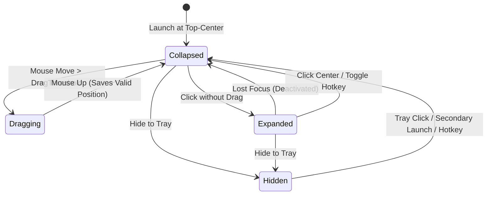

# ORBIT 2.0 — Native Windows Desktop Companion

> **High-Performance, Always-On-Top Windows Companion built with .NET 10, C# 14, WPF, and Native Win32 APIs.**

---

## 🌌 Overview

**ORBIT** is a minimal futuristic desktop companion designed specifically for Windows 11. It rests unobtrusively on your desktop as an animated pill with expressive vector eyes, reacts to cursor interactions, seamlessly expands into an island card on click, collapses automatically on loss of focus, supports drag-to-reposition across multi-monitor setups, and remains permanently recoverable via the Windows System Tray.

### ✨ Completed Capabilities & Modes

1. **CTRL Mode (System Controls)**:
   - Compact 5-card horizontal control strip with equal dimensions.
   - **Microphone**: Live global Windows capture mute/unmute toggle.
   - **Wi-Fi**: Physical adapter enable/disable and real-time connected SSID detection.
   - **Bluetooth**: Radio toggle and connected Bluetooth device name/count reporting.
   - **System Volume**: Master audio endpoint mute toggle.
   - **Settings**: Instant launch of native Windows Settings (`ms-settings:`).

2. **DEV Mode (Developer Workspace Launcher)**:
   - Dedicated development workspace launcher with automatic system discovery.
   - Distinct, decoupled detection and icons for both **Antigravity** (multicoloured logo) and **Antigravity IDE** (blue waveform logo).
   - One-click **ACTIVATE** button launching or foregrounding all selected development tools.
   - **Manage Apps View**: Collapsible search, invisible scrollbar with smooth mouse-wheel scrolling, independent selection toggles, and JSON persistence (`dev_workspace.json`).

3. **Dynamic Responsive Layout**:
   - Screen-adaptive downward height expansion anchored to top screen position.
   - Smooth cubic easing transitions between Home, DEV, Manage Apps, and CTRL modes.

---

## 🛠️ Architecture & Technology Stack

| Layer | Technology | Description |
| :--- | :--- | :--- |
| **Framework** | **.NET 10 (`net10.0-windows`)** | Built on .NET 10 runtime with C# 14 language features |
| **UI Engine** | **WPF + XAML** | Hardware-accelerated vector rendering with smooth double animations |
| **Native APIs** | **Win32 P/Invoke (`user32.dll`)** | Modular `SetWindowPos`, `MonitorFromPoint`, `GetMonitorInfo`, `RegisterHotKey`, `SetWindowLongPtr` |
| **System Tray** | **Windows Forms `NotifyIcon`** | Native notification area icon with custom dark-themed context menu |
| **Concurrency & IPC** | **Named Mutex + Named Pipe** | Single-instance enforcement with cross-process restore signaling |
| **Dependency Injection** | **`Microsoft.Extensions.DependencyInjection`** | Clean separation of concerns between UI, services, and native platform |
| **Local Storage** | **`System.Text.Json`** | Persisted settings with coordinate validation in `%LOCALAPPDATA%\ORBIT` |
| **Testing** | **xUnit** | Automated unit tests covering clamping, coordinates, settings, and state machines |

---

## 📂 Project Structure

```
ORBIT-WPF/
├── Orbit.sln
├── Orbit/
│   ├── App.xaml / App.xaml.cs          # Application bootstrapper, single-instance mutex & tray setup
│   ├── MainWindow.xaml / cs            # Transparent floating window, animation state machine, drag handler
│   ├── GlobalUsings.cs                 # Resolves WPF vs WinForms type collisions
│   ├── app.manifest                    # PerMonitorV2 DPI awareness & Windows 11 compatibility
│   ├── Core/
│   │   ├── OrbitApplication.cs        # DI Container builder
│   │   ├── OrbitState.cs              # Companion visual & operational states
│   │   ├── OrbitSettings.cs           # Serialized user preferences
│   │   └── OrbitLogger.cs             # Thread-safe local file logging
│   ├── Models/
│   │   ├── MonitorInfo.cs             # Multi-monitor bounds, work areas, and DPI scale
│   │   └── WindowInfo.cs              # Desktop window representation
│   ├── Services/
│   │   ├── WindowLifecycleService.cs  # Visual state (Collapsed/Expanded) & visibility controller
│   │   ├── SingleInstanceService.cs   # Mutex & Named Pipe IPC listener
│   │   ├── SettingsService.cs         # JSON persistence & position validation
│   │   └── LoggingService.cs          # DI wrapper for logging
│   ├── UI/
│   │   ├── Mascot/
│   │   │   ├── EyeMascot.xaml / cs    # Vector sclera, pupils, catchlights, organic blinking, saccades
│   │   └── Panels/
│   │       ├── ExpandedIsland.xaml/cs # Expanded card with eyes, brand label, and quick actions
│   ├── Platform/
│   │   └── Windows/
│   │       ├── NativeMethods.cs       # P/Invoke signatures, constants & structures
│   │       ├── WindowPositionService.cs# Mouse drag thresholding & work-area clamping
│   │       ├── WindowsOverlayService.cs# WS_EX_TOOLWINDOW & HWND_TOPMOST management
│   │       ├── MonitorService.cs      # Multi-monitor discovery & coordinate clamping
│   │       ├── SystemTrayService.cs   # Windows taskbar NotifyIcon & context menu
│   │       └── GlobalHotkeyService.cs # System-wide hotkey hook (Win + Ctrl + O)
│   ├── Integrations/
│   │   ├── Desktop/                   # IWindowManager & WindowManager stub
│   │   ├── Browser/                   # IBrowserManager stub
│   │   └── Agents/                    # IAgentManager stub (Google Antigravity, Codex, Claude Code)
│   └── Resources/
│       └── Styles/
│           ├── Colors.xaml            # Dark charcoal, obsidian, and neon purple palette
│           └── Theme.xaml             # Typography, effects, and button styles
├── Orbit.Tests/
│   ├── CoordinateAndClampingTests.cs  # Clamping & multi-monitor tests
│   ├── SettingsValidationTests.cs     # Settings & invalid coordinate tests
│   └── LifecycleStateTests.cs         # State machine & transition tests
└── README.md
```

---

## 👁️ Visual Identity & Mascot Animations

- **Geometry**: Obsidian rounded pill (`#13131A`) framed by a subtle glowing purple neon border (`#7C3AED`) and soft outer shadow.
- **Organic Blinking**: Natural cubic spline keyframe animation (`1.0` -> `0.06` -> `1.0` scale) with randomized interval variation and organic double-blinks.
- **Saccadic Glance Tracking**: Pupils smoothly shift within the sclera every few seconds using quadratic ease transitions.
- **Specular Highlights**: Crisp white catchlights give life and curiosity to the eyes.
- **Idle Breathing Glow**: A subtle drop shadow breathing pulse between `0.35` and `0.65` opacity.

---

## 🔄 Interaction & State Machine



1. **State A: Collapsed**
   - Compact eyes-only pill (`140 x 56`).
   - Top-centre of the primary monitor on first launch.
   - Always-on-top, draggable, clickable.
2. **State B: Expanded**
   - Expands to island card (`320 x 220`).
   - Displays the expressive mascot eyes at the top, followed by the futuristic **ORBIT v2.0** label, status indicator, and quick action controls.
   - Automatically collapses smoothly back to the collapsed pill when focus is lost.
   - Preserves window coordinates without hiding the process.

---

## 🪟 Windows Native Integration & Reliability

- **No Alt-Tab / Taskbar Clutter**: Sets `WS_EX_TOOLWINDOW` while ensuring mouse hit testing and activation remain completely responsive.
- **No WS_EX_TRANSPARENT**: Fully interactive surface.
- **Boundary Clamping**: Constrains dragging and placement to the monitor's visible work area (accounting for Windows taskbars on any display edge and negative multi-monitor coordinates).
- **Single-Instance IPC**: Launching a secondary instance signals the active instance over named pipes (`Orbit_DesktopCompanion_IPC_Pipe_v2`) to restore and focus the companion.
- **System Tray**: Left-click restores companion; right-click opens quick menu (*Show*, *Hide*, *Reset Position*, *Exit*).
- **Global Hotkey**: Press <kbd>Win</kbd> + <kbd>Ctrl</kbd> + <kbd>O</kbd> anywhere in Windows to toggle ORBIT.

---

## 🚀 Building and Running

### Prerequisites
- Windows 10 / 11 (x64)
- .NET 10 SDK (`10.0.403` or later)

### Build Solution
```powershell
dotnet build ORBIT-WPF\Orbit.sln
```

### Run Automated Tests
```powershell
dotnet test ORBIT-WPF\Orbit.sln
```

### Run ORBIT
```powershell
dotnet run --project ORBIT-WPF\Orbit\Orbit.csproj
```

### Log File Location
Logs are continuously appended in:
```
%LOCALAPPDATA%\ORBIT\logs\orbit_YYYYMMDD.log
```
Settings are persisted in:
```
%LOCALAPPDATA%\ORBIT\settings.json
```
